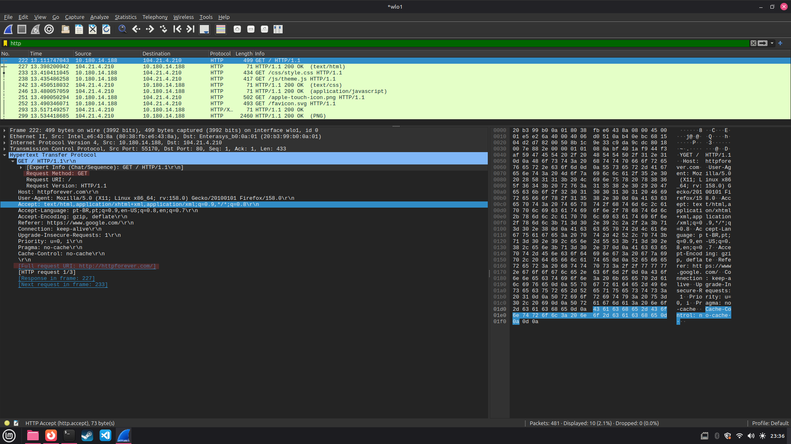
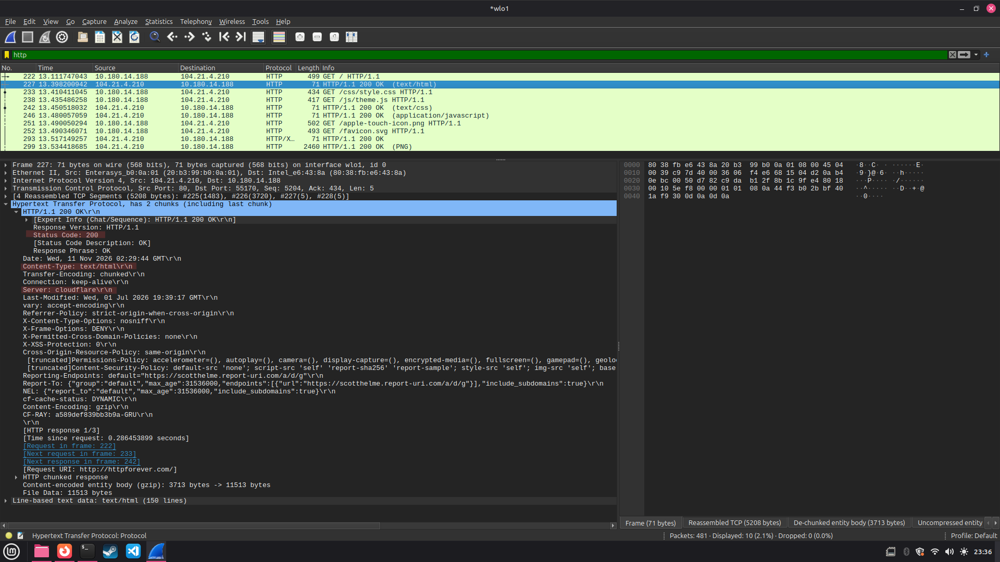

# Exercício 5 - Tráfego HTTP

## Como executar

1. Abrir o Wireshark no Linux
2. Escolher a rede `wlo1` e começar a captura
3. Entrar no site http://httpforever.com/ pelo navegador
4. Parar a captura e colocar `http` no filtro
5. Abrir os pacotes 222 e 227 para ver as informações da requisição e da resposta

**Para fazer o exercício:** ter o Wireshark instalado

## O que foi observado

Quando entrei no site http://httpforever.com/, apareceu uma requisição usando o método GET  
Depois o servidor respondeu com o código 200 OK, que significa que deu tudo certo  
No Content-Type apareceu text/html, que mostra que o servidor enviou uma página HTML  
No Server apareceu cloudflare, que é o servidor que respondeu à requisição

## Capturas de tela

**Requisição HTTP (GET)**

**Resposta HTTP (200 OK)**

