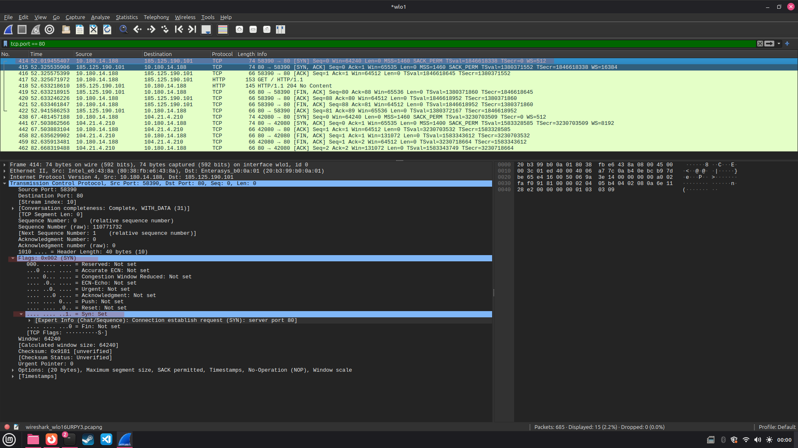
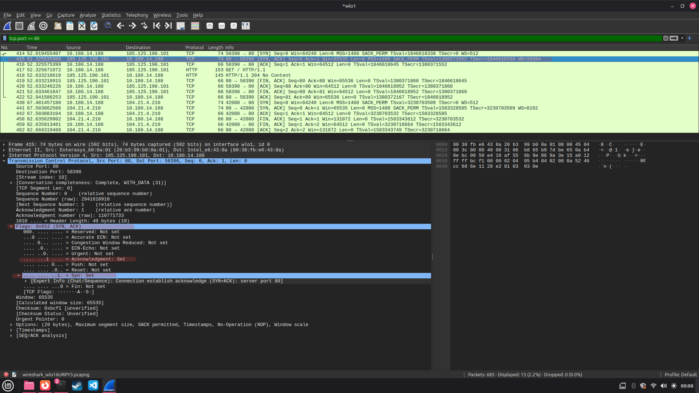
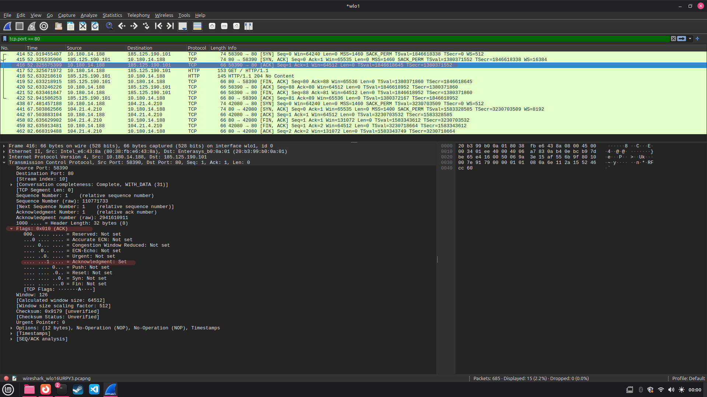
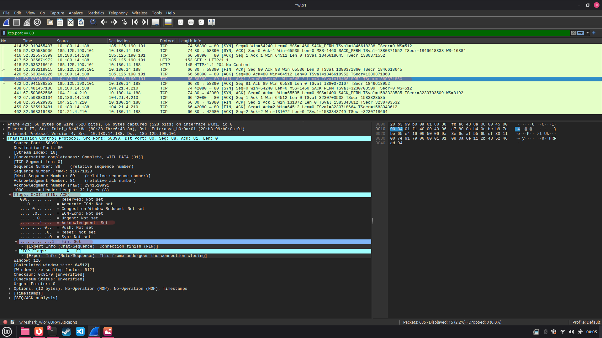

# Exercício 6 - Conexão TCP

## Integrantes

- Italo Tadeu Pereira Almeida
- Hendryl Figueiredo Miranda
- João Victor Silva Soares

## Como executar

1. Abrir o Wireshark no Linux
2. Escolher a rede `wlo1` e iniciar a captura
3. Abrir o terminal e colocar o comando `telnet httpforever.com 80`
4. Para fechar a conexão, apertar `Ctrl + ]` e depois digitar `quit`
5. Voltar ao Wireshark, parar a captura e colocar `tcp.port == 80` no filtro
6. Procurar os pacotes SYN, SYN-ACK, ACK e FIN-ACK

**Para fazer o exercício:** ter o Wireshark e o telnet instalados

## O que foi observado

Quando usei o telnet para conectar ao servidor, consegui ver os três pacotes que começam a conexão TCP  
Primeiro apareceu o SYN, depois o SYN-ACK e em seguida o ACK, mostrando que a conexão tinha dado certo  
Quando fechei a conexão, apareceu o FIN-ACK e depois outro ACK enviado pelo servidor  
Com isso consegui ver pelo Wireshark como uma conexão TCP é iniciada e depois encerrada

## Capturas de tela

**Início da conexão — SYN**

**Resposta do servidor — SYN-ACK**

**Confirmação — ACK**

**Encerramento — FIN-ACK**

