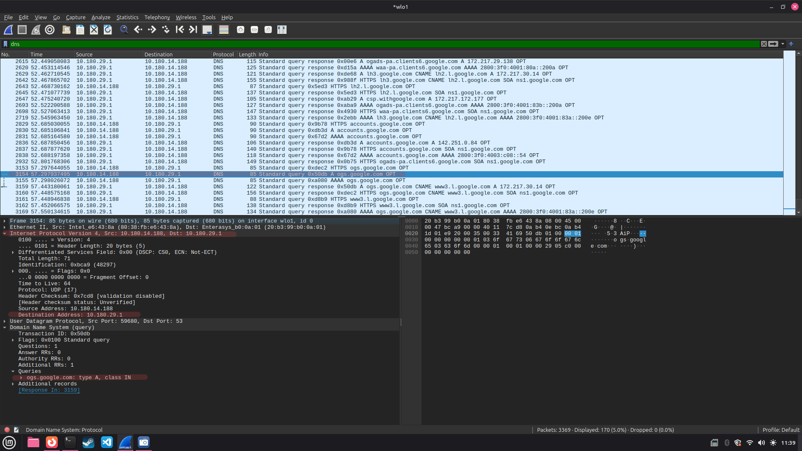
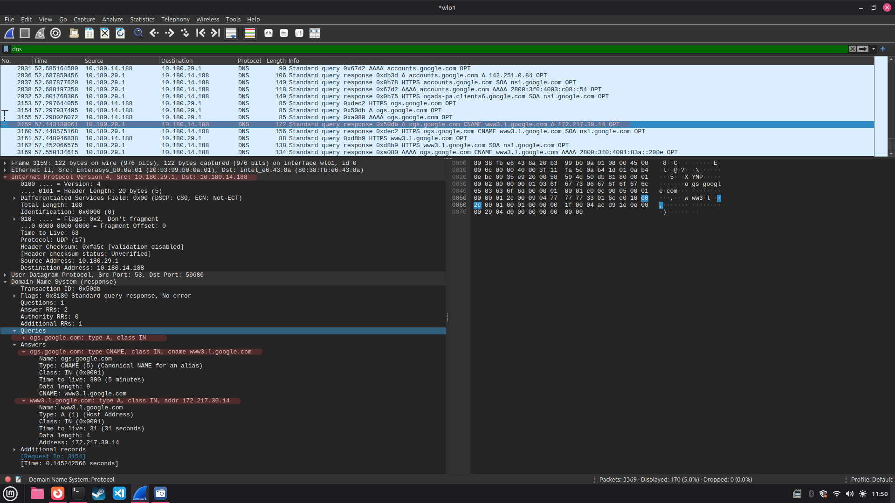

# Exercício 7 - Resolução de Nomes via DNS

## Integrantes

- Italo Tadeu Pereira Almeida
- Hendryl Figueiredo Miranda
- João Victor Silva Soares

## Como executar

1. Abrir o Wireshark no Linux
2. Escolher a rede `wlo1` e iniciar a captura
3. Abrir o navegador e entrar no site https://www.google.com/
4. Voltar ao Wireshark, parar a captura e colocar `dns` no filtro
5. Procurar os pacotes 3154 e 3159 para ver as informações da consulta e da resposta DNS

**Para fazer o exercício:** ter o Wireshark e um navegador instalados

## O que foi observado

Wntrei no Google, consegui ver uma consulta DNS para o endereço ogs.google.com, usando o registro do tipo A 
A consulta foi enviada para o servidor DNS 10.180.29.1, ele respondeu com as informações do endereço 
Na resposta apareceu um registro CNAME apontando para www3.l.google.com e um registro A com o IP 172.217.30.14 

## Capturas de tela

**Consulta DNS - Registro A**

**Resposta DNS - CNAME e endereço IP**

