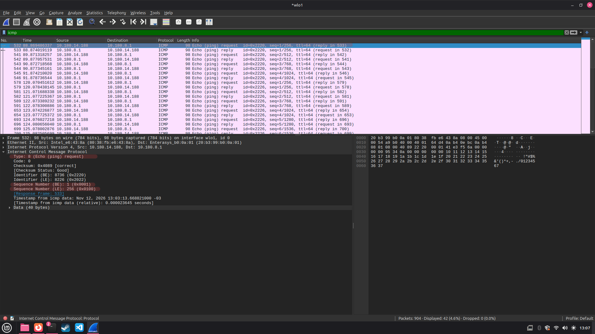
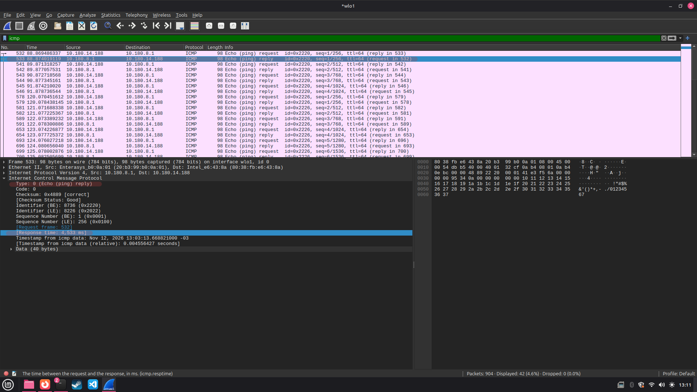
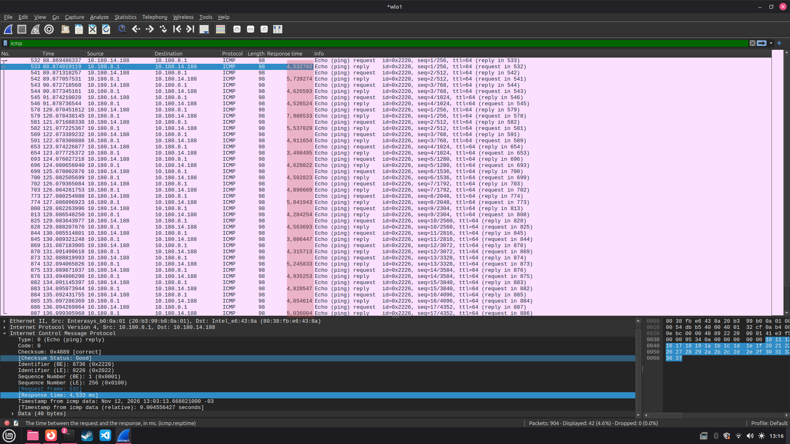

# Exercício 8 - Tráfego ICMP (Ping)

## Como executar

1. Abrir o Wireshark no Linux
2. Escolher a rede `wlo1` e iniciar a captura
3. Abrir o terminal e executar o comando `ping` para o endereço `10.180.8.1`
4. Voltar ao Wireshark, parar a captura e colocar `icmp` no filtro
5. Procurar os pacotes Echo Request e Echo Reply e verificar o tempo de resposta de cada um

**Para fazer o exercício:** ter o Wireshark e o comando ping instalados

## O que foi observado

Usei o ping para testar a conexão com o endereço 10.180.8.1,  consegui ver os pacotes ICMP sendo enviados 
Apareceram as mensagens Echo Request e depois as Echo Reply, seguindo a ordem logica de pergunta e resposta, mostrando que o dispsitivo estava respondendo 
Também consegui ver o tempo de ida e volta de cada ping (RTT), que ficou entre 4 e 5 ms

## Capturas de tela

**Solicitação ICMP - Eco Request**

**Resposta ICMP - Echo Reply**

**Tempo de resposta dos pacotes - RTT**

