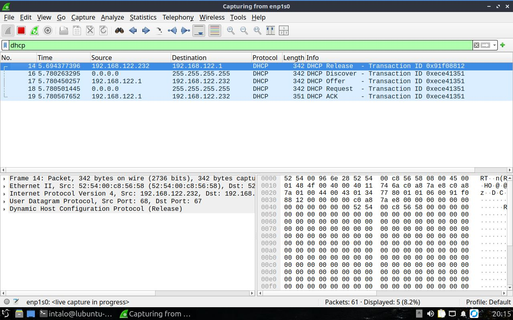

# Exercício 6 - Conexão TCP

## Integrantes

- Italo Tadeu Pereira Almeida
- Hendryl Figueiredo Miranda
- João Victor Silva Soares

## Como executar

1. Abrir o Wireshark no Linux
2. Escolher a rede `wlo1` e iniciar a captura
3. Abrir o terminal e colocar o comando `sudo dhclient -r && sudo dhclient`
4. Voltar ao Wireshark, parar a captura e colocar `dhcp` no filtro
6. Procurar os pacotes DISCOVERY, OFFER, REQUEST, ACKNOWLEDGE

**Para fazer o exercício:** ter o Wireshark e o isc-dhcp-client instalados

## O que foi observado

Quando usei o telnet para conectar ao servidor, consegui ver os quatros pacotes que configuram o host na rede  
Primeiro apareceu o DISCOVERY, depois o OFFER, depois o REQUEST e por fim o ACKNOWLEDGE mostrando que a configuração tinha dado certo  
Com isso consegui ver pelo Wireshark como um host pede configuração a um servidor DHCP

## Capturas de tela

